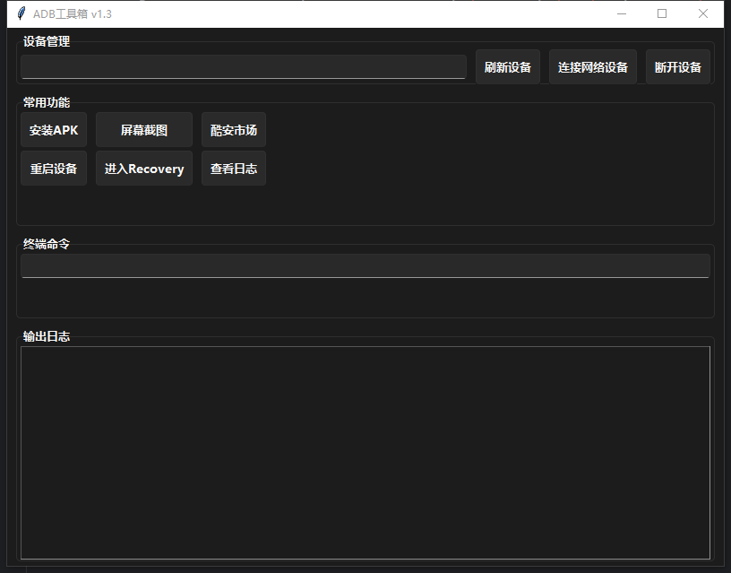

# ADB 工具箱

一个基于 Python + tkinter 的 Windows 端 ADB 图形工具：把常用 adb 操作做成按钮，不用记命令。



> 截图来自 v1.1，v1.4 多了一个「配对(安卓11+)」按钮，其余布局一致。

## 功能

**设备管理**

- 自动列出 USB 与已连接的无线设备，并显示 `offline` / `unauthorized` 状态
- 下拉框切换目标设备，后续所有操作都发给选中的那台
- 无线连接：`连接网络设备` 输入 `IP:端口` 即可
- 无线配对：Android 11 及以上必须先配对，点「配对(安卓11+)」输入配对地址和 6 位配对码
- `断开设备` 断开无线连接

**常用操作**

- 安装 APK：`adb install -r`，大包不会因为超时误报失败，装完弹窗告知成功或失败原因
- 屏幕截图：保存到 `图片\ADB工具箱\screenshot_时间戳.png`，并清理设备上的临时文件
- 重启设备 / 进入 Recovery
- 实时日志：独立窗口滚动显示 `logcat`，关闭窗口即结束进程，不占用界面
- 酷安市场：浏览器打开酷安 APK 页面

**adb 命令框**

直接输入 adb 子命令，不用写 `adb` 前缀，例如：

```text
shell pm list packages
devices -l
install -r D:\apk\demo.apk
```

注意：命令按「一条」执行，不经过 shell，所以 `&&`、`|`、`>` 重定向都不可用；需要管道请直接在终端里操作。

## 环境要求

- Windows 10 / 11
- Python 3.9+（用到了 `X | None` 这类标注，推荐 3.10 及以上）
- [Android platform-tools](https://developer.android.com/tools/releases/platform-tools)（提供 `adb.exe`）
- 手机已开启「开发者选项 → USB 调试」

## 快速开始

```powershell
git clone https://github.com/fish9604/fish9504-s_ADB_tools_box.git
cd fish9504-s_ADB_tools_box
pip install -r requirements.txt
python tools_box.py
```

`requirements.txt` 里只有 `sv-ttk` 一个运行依赖（深色主题）。没装也能启动，只是界面变回系统默认样式。

### 找不到 adb 怎么办

启动时会检查 `adb version`，失败会弹窗提示。按以下任一方式处理：

1. 安装 platform-tools，并把它的目录加入 `PATH`；
2. 把 `adb.exe` 放到 `tools_box.py`（或打包后的 exe）同目录；
3. 设置环境变量 `ADB_PATH` 指向 `adb.exe` 的完整路径。

查找顺序就是上面这三条：`ADB_PATH` → 程序目录 → `PATH`。

## 打包成 exe

```powershell
pip install pyinstaller
pyinstaller tools_box.spec
```

产物在 `dist\tools_box\`，**分发时要把整个目录压缩后发出**（这是目录形态的打包，不是单文件），对方解压后运行 `tools_box.exe`。

spec 里已经处理了两件事：把窗口图标设为 `favicon.ico`；把 `sv-ttk` 的 `.tcl` 主题文件一并打包——否则 exe 启动时会报 `can't read sv.tcl`，深色主题失效。

## 常见问题

**设备显示 `unauthorized`**

手机上会弹出「允许 USB 调试吗」，点允许即可。没弹窗的话拔掉数据线重插，或到开发者选项里「撤销 USB 调试授权」后重连。

**Android 11+ 无线调试连不上**

系统把「配对」和「连接」拆成了两个端口。先点手机的「使用配对码配对设备」拿到配对地址和 6 位码，用「配对(安卓11+)」完成配对；再点「连接网络设备」，输入无线调试页面上显示的**连接**端口（通常是 5555）。

**截图存到哪了**

`C:\Users\<你的用户名>\Pictures\ADB工具箱\`。如果该目录不可写，会退回系统临时目录，路径会打印在日志区。

**点按钮没反应**

先在日志区看最后一行输出。常见原因是没选设备（会弹窗提示）或 adb 路径不对。

## 目录结构

```text
tools_box.py      # 主程序，单文件
tools_box.spec    # PyInstaller 打包配置
requirements.txt  # 运行依赖
favicon.ico       # 窗口图标
1.1截图.png        # 界面截图
```

## 更新记录

**v1.4**

- 修复「连接网络设备」因未导入 `simpledialog` 导致的必然崩溃
- 修复实时日志阻塞界面线程、关窗不结束进程的问题
- 修复 `adb devices` 的 daemon 提示行被当作设备、忽略 `unauthorized` 状态的问题
- 修复下拉框切换设备不生效的问题
- 安装/重启不再使用固定 10 秒超时
- 截图改为保存到「图片」目录并校验结果，清理设备端临时文件
- 启动时检查 adb 是否可用；统一 UTF-8 解码；打包后不再闪控制台黑框
- 新增无线调试配对、成功/失败弹窗、高分屏 DPI 适配

## 许可

[MIT](LICENSE)
